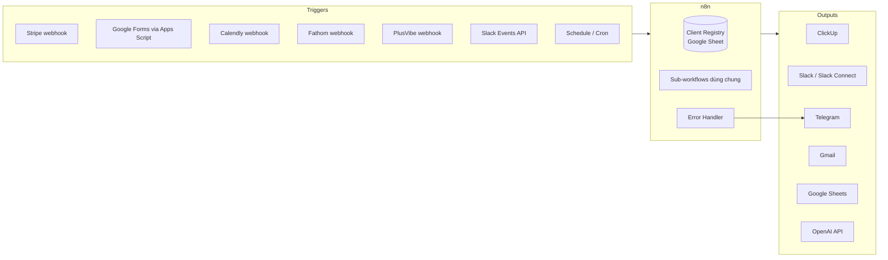

# Kế hoạch triển khai: n8n Client Onboarding & Reporting Automations

> Tài liệu kỹ thuật cho dự án xây dựng khoảng 19 workflow n8n, kết nối Stripe, Calendly, Google Forms, ClickUp, Slack, Telegram, PlusVibe, Fathom, Google Sheets, Gmail và OpenAI API.
> **Thay đổi so với tin tuyển dụng:** dùng **OpenAI** thay cho Claude API (tin tuyển dụng chấp nhận cả hai: "Claude or OpenAI").
> **Mục đích: dự án portfolio.** Dự án được dựng lại từ một tin tuyển dụng Upwork có thật, để chứng minh năng lực với khách hàng tương lai. Vì không có khách hàng thật, mọi chỗ đánh dấu **[Cần xác nhận]** sẽ do bạn tự quyết định (xem mục 8). Mục 10 nói cách chạy dự án với chi phí gần bằng 0, mục 11 nói cách đóng gói để trình bày.

---

## 1. Mục tiêu và phạm vi

| Hạng mục | Nội dung |
|---|---|
| Mục tiêu | Tự động hóa toàn bộ vòng đời khách hàng, từ lúc thanh toán đến onboarding và báo cáo hàng tuần |
| Số workflow | Khoảng 19 (gồm cả workflow dùng chung và error handler) |
| Môi trường | n8n của khách hàng (cloud hoặc self-host) **[Cần xác nhận]** |
| Milestone | M1 Onboarding → M2 Reporting → M3 Extras |
| Bàn giao | Workflow chạy production, test end-to-end với test client, mỗi workflow có video Loom |
| Nguyên tắc | Không có lỗi âm thầm: mọi lỗi đều báo về Telegram |

---

## 2. Kiến trúc tổng thể

### 2.1 Sơ đồ luồng



### 2.2 Nguyên tắc thiết kế

1. **Client Registry là nguồn dữ liệu trung tâm (single source of truth).** Mỗi khách hàng có đúng một dòng, chứa mọi ID liên kết (Stripe, ClickUp, Slack, email). Mọi workflow tra cứu khách qua registry, không đoán từ tên.
2. **Idempotency.** Webhook có thể gửi lặp (Stripe, Calendly đều retry). Dùng node **Remove Duplicates** (chế độ *Remove Items Repeated Within Previous Executions*) với khóa `event_id`. n8n tự lưu các khóa đã gặp, không cần sheet riêng.
3. **Sub-workflow dùng chung** (gọi bằng *Execute Workflow*) cho các việc lặp lại: tìm khách, gửi Telegram, cập nhật ClickUp. Sửa một chỗ là áp dụng cho tất cả.
4. **Mọi workflow đều trỏ tới Error Workflow** (Settings → Error Workflow).
5. **Chỉ có một Slack Request URL.** Slack chỉ cho mỗi app một Event Subscription URL, nên cần một workflow router nhận mọi event rồi phân phối đi.
6. **Cấu hình tách khỏi logic.** Chat ID của Telegram, ID của ClickUp list, template ID, mốc thời gian nhắc... đặt trong một node `Config` (hoặc n8n Variables nếu gói của khách hỗ trợ), không hard-code rải rác.

### 2.3 Lưu trữ trạng thái: Client Registry (Google Sheet)

Sheet `Clients` (dòng tiêu đề có sẵn trong `sheets-template/Clients.csv`):

| Cột | Mô tả |
|---|---|
| `client_id` | ID nội bộ (ví dụ `CL-251022-093015`) |
| `company_name`, `contact_name`, `contact_email` | Thông tin khách |
| `plan_name`, `amount`, `currency` | Gói dịch vụ và số tiền thanh toán |
| `stripe_customer_id`, `stripe_subscription_id`, `stripe_session_id` | Liên kết Stripe |
| `clickup_task_id`, `clickup_task_url` | Thẻ ClickUp của khách |
| `slack_channel_id`, `slack_invite_id` | Kênh Slack Connect |
| `slack_invite_accepted_at` | Thời điểm khách chấp nhận lời mời |
| `paid_at` | Thời điểm thanh toán lần đầu |
| `sales_form_at`, `onboarding_form_at` | Thời điểm nộp form |
| `call_booked_at`, `call_scheduled_for`, `call_status` | Trạng thái Calendly (booked / no_show / canceled / done) |
| `fathom_recap_at` | Thời điểm đã có recap |
| `plusvibe_campaign_ids` | Danh sách campaign của khách |
| `renewal_date` | Ngày gia hạn |
| `health_status` | green / yellow / red |
| `status` | provisioning / onboarding / needs_attention / active / paused / churned |
| `last_nudge_call_at`, `last_nudge_form_at`, `last_nudge_slack_at` | Chống gửi nhắc trùng (một cột cho mỗi loại nhắc) |
| `notes` | Các bước lỗi cần xử lý tay (ví dụ Slack hoặc email không gửi được) |

Các sheet phụ:
- `Reply_Log`: log các reply từ PlusVibe (xem mục 4.2)
- `Weekly_Stats`: số liệu hàng tuần (xem mục 4.2)

> **Phương án thay thế:** nếu n8n của khách có **Data Tables** hoặc một Postgres riêng thì nên dùng để lưu state (nhanh hơn, không bị rate limit của Google Sheets), còn Google Sheets chỉ dùng cho các báo cáo mà con người cần đọc. **[Cần xác nhận]**

---

## 3. Chuẩn bị (Phase 0), khoảng 4 đến 6 giờ

### 3.1 Credentials và quyền cần khách cung cấp

| Dịch vụ | Cần có | Ghi chú |
|---|---|---|
| Stripe | Restricted API key + Webhook signing secret | Dùng **test mode** khi phát triển |
| ClickUp | API token, Workspace/Space/List ID, Task Template ID | Danh sách custom field và ID của từng field |
| Slack | Slack App với Bot token | **Slack Connect cần gói trả phí (Pro trở lên)**. Scopes: `channels:manage`, `channels:read`, `chat:write`, `conversations.connect:write`, `reactions:read`, `channels:history`, `users:read.email` |
| Telegram | Bot token (tạo qua @BotFather), chat ID của group team | Nên tách riêng group "Alerts" và group "Errors" |
| Google | OAuth cho Sheets, Gmail, Forms | Gmail gửi từ địa chỉ nào? **[Cần xác nhận]** |
| Calendly | Personal Access Token | Webhook cần gói Standard trở lên |
| Fathom | API key / cấu hình webhook | |
| PlusVibe | API key + workspace ID | Cấu hình webhook trong PlusVibe |
| OpenAI | API key (đặt usage limit trong OpenAI dashboard) | Model đề xuất: `gpt-5-mini` cho recap và client update (kiểm tra danh sách model hiện tại trước khi chốt) |

### 3.2 Thiết lập nền tảng
- Đặt tên workflow theo quy ước `[ONB-01] Stripe Payment → Kickoff`, `[REP-01] ...`, `[SYS-01] ...`
- Tag workflow theo milestone: `onboarding`, `reporting`, `system`
- Tạo **test client**: email test, Stripe test customer, ClickUp list test, Slack workspace test để nhận lời mời Slack Connect
- Lấy spec chi tiết từ khách (nội dung tin nhắn, template, mốc thời gian)

---

## 4. Danh sách workflow chi tiết

### 4.0 Workflow hệ thống (dùng chung): SYS

#### SYS-01: Global Error Handler
- **Trigger:** Error Trigger
- **Xử lý:** lấy tên workflow, node lỗi, thông báo lỗi, link tới execution
- **Output:** gửi Telegram vào group Errors theo mẫu:
  ```
  🚨 Workflow lỗi: [ONB-01] Stripe Payment → Kickoff
  Node: Create ClickUp Task
  Lỗi: 401 Unauthorized
  Execution: https://n8n.xxx/execution/1234
  ```
- Áp dụng cho **tất cả** workflow khác (Settings → Error Workflow)
- Bổ sung: bật **Retry On Fail** (3 lần, cách nhau 5 giây) cho các node HTTP/API

#### SYS-02: Notify Telegram (sub-workflow)
- Input: `chat` (alerts/errors), `message`, `parse_mode`
- Gom định dạng và chat ID về một chỗ

#### SYS-03: Client Lookup (sub-workflow)
- Input: một trong các khóa `email` / `stripe_customer_id` / `slack_channel_id` / `clickup_task_id`
- Output: toàn bộ dòng của khách trong registry, hoặc báo lỗi "không tìm thấy" (lỗi này sẽ kích hoạt Telegram alert)

#### SYS-04: Slack Events Router
- **Trigger:** Webhook (Slack Event Subscriptions Request URL)
- Xử lý `url_verification` challenge
- Xác thực `X-Slack-Signature` bằng signing secret
- **Trả 200 ngay lập tức** (Slack retry nếu không nhận phản hồi trong 3 giây), sau đó phân luồng:
  - `shared_channel_invite_accepted` → cập nhật `slack_invite_accepted_at` và ClickUp
  - `message` / `reaction_added` trong kênh khách → chuyển cho REP-02 (theo dõi việc đã reply hay chưa)
- Bỏ qua tin nhắn do chính bot gửi

---

### 4.1 Milestone 1: Onboarding (ONB)

#### ONB-01: Stripe Payment → Kickoff (workflow quan trọng nhất)
- **Trigger:** Stripe Trigger, event `checkout.session.completed` hoặc `invoice.paid` (chỉ lấy lần thanh toán đầu, `billing_reason = subscription_create`) **[Cần xác nhận event nào]**
- **Các bước:**
  1. Bỏ qua event trùng bằng node Remove Duplicates (khóa `event.id`)
  2. Lấy thông tin khách: tên, email, công ty (từ Stripe customer và metadata)
  3. Tạo `client_id` và thêm dòng vào registry
  4. **ClickUp:** tạo task từ template (`POST /list/{list_id}/taskTemplate/{template_id}`), đặt tên, điền custom field (email, gói, ngày thanh toán)
  5. **Slack Connect:**
     - `conversations.create` tạo kênh `client-<company-slug>`
     - `conversations.inviteShared` mời qua email khách
     - `chat.postMessage` gửi lời chào (theo mẫu trong spec)
  6. **Gmail:** gửi email chào mừng (HTML template, gồm link form onboarding và link Calendly)
  7. Lưu `clickup_task_id` và `slack_channel_id` vào registry
  8. **Telegram:** `💰 Khách mới: <Company> – <gói> – <số tiền>`
- **Xử lý lỗi riêng:** nếu bước Slack lỗi (ví dụ email khách không hợp lệ) thì vẫn tiếp tục các bước còn lại và báo Telegram cần xử lý tay (bật *Continue On Fail* cho nhánh Slack)

#### ONB-02: Sales Handoff Form
- **Trigger:** Google Form, gửi qua Apps Script `onFormSubmit` tới n8n webhook (tức thì, không phải polling)
  - Phương án dự phòng: Google Sheets Trigger trên sheet liên kết với form (polling mỗi phút)
- **Các bước:**
  1. Tìm khách qua email hoặc tên công ty (SYS-03)
  2. Map từng câu trả lời vào custom field của ClickUp
  3. Kiểm tra các trường bắt buộc; nếu thiếu thì gửi Slack (kênh nội bộ) và Telegram: `⚠️ Sales handoff <Company> thiếu: ICP, offer`
  4. Cập nhật `sales_form_at`

#### ONB-03: Client Onboarding Form
- Cấu trúc giống ONB-02, nhưng với form do khách điền
- Nếu thiếu thông tin: nhắc khách trong kênh Slack Connect của họ (theo spec) và báo team qua Telegram
- Cập nhật `onboarding_form_at` và chuyển trạng thái ClickUp (ví dụ sang "Form received")

#### ONB-04: Calendly Booking
- **Trigger:** Calendly Trigger, event `invitee.created`
- Lọc theo event type của cuộc gọi onboarding
- Tìm khách qua email, cập nhật ClickUp (ngày gọi, status) và registry (`call_booked_at`, `call_scheduled_for`)
- Telegram: `📅 <Company> đã đặt call lúc <time>`

#### ONB-05: Calendly No-show / Cancel
- **Trigger:** Calendly webhook `invitee_no_show.created` và `invitee.canceled`
- Cập nhật `call_status`, chuyển trạng thái ClickUp, gửi Telegram alert
- (Tùy spec) gửi khách link đặt lại lịch qua Slack hoặc email

#### ONB-06: Fathom Transcript → OpenAI Recap
- **Trigger:** Fathom webhook khi có recording hoặc transcript mới
- **Các bước:**
  1. Xác định khách theo email người tham dự
  2. Gọi OpenAI bằng node **OpenAI** có sẵn của n8n (hoặc HTTP Request tới `https://api.openai.com/v1/chat/completions`), model `gpt-5-mini`
     - Bật **Structured Outputs** (`response_format: json_schema`) để OpenAI luôn trả đúng schema
     - System prompt: định dạng recap theo spec (mục tiêu, ICP, offer, việc cần làm tiếp...)
     - Yêu cầu trả về **JSON có cấu trúc** để map vào từng custom field của ClickUp
  3. Kiểm tra JSON hợp lệ; nếu lỗi thì retry 1 lần, sau đó báo Telegram
  4. Điền custom field và đăng recap thành comment trên task ClickUp
  5. Cập nhật `fathom_recap_at` và `call_status = done`

#### ONB-07 đến ONB-10: Time-based Checks
Gom vào **một workflow chạy theo lịch** (Schedule mỗi ngày lúc 9h sáng theo timezone của khách) có 4 nhánh, hoặc tách làm 4 workflow nếu spec yêu cầu. Mỗi nhánh đọc registry, lọc theo điều kiện, kiểm tra `last_nudge_*_at` để không nhắc trùng.

| WF | Điều kiện | Hành động |
|---|---|---|
| ONB-07 No call booked | `paid_at` > X ngày và `call_booked_at` trống | Nhắc khách (Slack/email), báo Telegram |
| ONB-08 Form missing | `paid_at` > X ngày và `onboarding_form_at` trống | Nhắc khách, báo Telegram |
| ONB-09 Slack invite not accepted | `paid_at` > X giờ và `slack_invite_accepted_at` trống | Gửi lại email kèm hướng dẫn chấp nhận lời mời, báo Telegram |
| ONB-10 Tasks overdue | ClickUp API: task có `due_date < now` và chưa xong | Báo Telegram hoặc Slack nội bộ, liệt kê task |

- Mốc X lấy từ node Config **[Cần xác nhận theo spec]**
- Có thể tăng dần mức nhắc: lần 1 nhắc khách, lần 2 nhắc khách và báo team, lần 3 chỉ báo team (cần xử lý tay)

---

### 4.2 Milestone 2: Reporting (REP)

#### REP-01: PlusVibe Reply Webhook → Slack + Sheets
- **Trigger:** webhook từ PlusVibe (event có reply mới hoặc positive reply) **[Cần xác nhận event type]**
- **Các bước:**
  1. Map `campaign_id` sang khách qua cột `plusvibe_campaign_ids`
  2. Đăng vào kênh Slack của khách: tên lead, công ty, nội dung reply, link
  3. Ghi vào sheet `Reply_Log`: `reply_id`, `client_id`, `lead_email`, `received_at`, `slack_ts`, `responded_at`, `nudge_count`
- Lưu `slack_ts` (timestamp của tin nhắn) để REP-02 theo dõi

#### REP-02: Reply Nudge (nhắc khi chưa ai phản hồi)
- **Cách xác định "đã phản hồi":** qua SYS-04, khi có `reaction_added` hoặc message trong thread có `thread_ts = slack_ts` thì ghi `responded_at`
- **Trigger:** Schedule chạy mỗi giờ
- Lọc các dòng `Reply_Log` có `responded_at` trống và đã quá N giờ, rồi nhắc trong thread Slack và báo Telegram (tăng `nudge_count`, giới hạn số lần nhắc)

#### REP-03: Weekly Stats (thứ Năm)
- **Trigger:** Schedule thứ Năm hàng tuần, giờ theo spec
- Với mỗi khách đang active: gọi PlusVibe API lấy số liệu 7 ngày (sent, opens, replies, positive replies, bounces)
- Thêm dòng vào sheet `Weekly_Stats`: `week`, `client_id`, các chỉ số, và mức thay đổi so với tuần trước
- Gửi tóm tắt Telegram cho team, mỗi khách một dòng:
  ```
  📊 Weekly – Tuần 43
  • Acme: 1,200 sent | 24 replies | 6 positive (+2)
  • Beta: 800 sent | 5 replies | 0 positive ⚠️
  ```
- Dùng **Loop Over Items** và nghỉ giữa các lần gọi để tránh rate limit

#### REP-04: Account Health Alerts
- Chạy ngay sau REP-03 hoặc hàng ngày
- Quy tắc tính health (cần lấy theo spec), ví dụ:
  - 🔴 Red: 0 positive reply trong 2 tuần, bounce rate > 5%, hoặc khách không tương tác trên Slack 14 ngày
  - 🟡 Yellow: số positive giảm hơn 50% so với tuần trước
- Cập nhật `health_status`; **chỉ báo Telegram khi trạng thái thay đổi** để tránh spam

#### REP-05: Renewal Alerts
- Schedule hàng ngày, đọc `renewal_date` (hoặc lấy `current_period_end` từ Stripe subscription)
- Báo Telegram trước ngày gia hạn 14, 7 và 3 ngày, kèm health status để team chuẩn bị

#### REP-06: Friday Client Update (do OpenAI soạn)
- **Trigger:** Schedule thứ Sáu
- Với mỗi khách: lấy dữ liệu tuần từ `Weekly_Stats` và `Reply_Log`, rồi gọi OpenAI soạn bản cập nhật theo giọng văn và template trong spec
- **Bước duyệt (đề xuất):** gửi bản nháp vào kênh Slack nội bộ hoặc Telegram kèm nút *Approve / Edit*; khi duyệt mới đăng vào kênh khách. Nếu khách không cần bước duyệt thì đăng thẳng. **[Cần xác nhận]**

---

### 4.3 Milestone 3: Extras
Theo tin tuyển dụng, phần "extras" chưa được nêu rõ. Dự kiến gồm:
- Các workflow còn lại trong spec chưa thuộc M1 và M2
- Dashboard tổng hợp trong Google Sheets (pivot theo khách và theo tuần)
- Hoàn thiện tài liệu, video Loom, buổi bàn giao

### 4.4 Bảng tổng hợp workflow

| # | Mã | Tên | Trigger | Milestone |
|---|---|---|---|---|
| 1 | SYS-01 | Global Error Handler | Error Trigger | M1 |
| 2 | SYS-02 | Notify Telegram | Sub-workflow | M1 |
| 3 | SYS-03 | Client Lookup | Sub-workflow | M1 |
| 4 | SYS-04 | Slack Events Router | Webhook | M1 |
| 5 | ONB-01 | Stripe Payment → Kickoff | Stripe | M1 |
| 6 | ONB-02 | Sales Handoff Form | Apps Script webhook | M1 |
| 7 | ONB-03 | Client Onboarding Form | Apps Script webhook | M1 |
| 8 | ONB-04 | Calendly Booking | Calendly | M1 |
| 9 | ONB-05 | Calendly No-show/Cancel | Calendly | M1 |
| 10 | ONB-06 | Fathom → OpenAI Recap | Fathom | M1 |
| 11 | ONB-07 | Check: No call booked | Schedule | M1 |
| 12 | ONB-08 | Check: Form missing | Schedule | M1 |
| 13 | ONB-09 | Check: Slack invite pending | Schedule | M1 |
| 14 | ONB-10 | Check: Tasks overdue | Schedule | M1 |
| 15 | REP-01 | PlusVibe Reply → Slack + Sheets | Webhook | M2 |
| 16 | REP-02 | Reply Nudge | Schedule | M2 |
| 17 | REP-03 | Weekly Stats (Thu) | Schedule | M2 |
| 18 | REP-04 | Account Health Alerts | Schedule | M3 |
| 19 | REP-05 | Renewal Alerts | Schedule | M3 |
| 20 | REP-06 | Friday Client Update | Schedule | M3 |
| 21 | SYS-05 | Demo Reset (chỉ dùng cho bản demo public) | Schedule | Deploy |

---

## 5. Kiểm thử

### 5.1 Quy trình test cho từng workflow
1. **Unit:** dùng *pinned data* trong n8n với payload mẫu để test từng nhánh (thành công, thiếu dữ liệu, trùng event)
2. **Integration:** gửi event thật từ môi trường test (Stripe CLI `stripe trigger checkout.session.completed`, đặt lịch Calendly thật, nộp form thật)
3. **Error path:** cố tình làm hỏng credential hoặc input để xác nhận có Telegram alert
4. **Idempotency:** gửi lại cùng một event và xác nhận không tạo thẻ hoặc kênh trùng

### 5.2 Kịch bản end-to-end với test client
```
Thanh toán Stripe (test mode)
  → thẻ ClickUp được tạo, có kênh Slack Connect và lời mời, nhận email chào mừng, nhận Telegram
  → nộp Sales form, nộp Client form (để thiếu 1 trường) → có cảnh báo thiếu thông tin
  → đặt Calendly → ClickUp cập nhật
  → Fathom transcript mẫu → recap được điền vào ClickUp
  → giả lập thời gian (sửa ngày trong registry) → các nudge chạy đúng
  → PlusVibe reply mẫu → có tin Slack và log trong Sheet → không phản hồi → có nudge
  → chạy tay REP-03, REP-04, REP-05, REP-06 → kiểm tra Sheet, Telegram, bản nháp
```

### 5.3 Checklist nghiệm thu cho mỗi workflow
- [ ] Chạy đúng với test client
- [ ] Error Workflow đã được gán
- [ ] Không gửi trùng khi event lặp lại
- [ ] Nội dung tin nhắn khớp spec
- [ ] Không có giá trị hard-code ngoài node Config
- [ ] Đã quay Loom walkthrough
- [ ] Đã bật Active

---

## 6. Rủi ro và cách xử lý

| Rủi ro | Ảnh hưởng | Cách xử lý |
|---|---|---|
| Slack workspace không có gói trả phí | Không tạo được Slack Connect | Xác nhận gói Slack từ đầu; phương án dự phòng là mời khách làm guest |
| Khách dùng email khác nhau giữa Stripe, Calendly và Form | Không tìm được khách | Tra cứu theo nhiều khóa (email, domain, tên công ty); nếu không khớp thì báo Telegram để xử lý tay |
| Webhook bị gửi lặp | Thẻ hoặc kênh bị tạo trùng | Node Remove Duplicates theo `event_id` |
| Rate limit (Google Sheets, PlusVibe, ClickUp) | Workflow lỗi khi có nhiều khách | Gom request theo batch, thêm Wait, Retry On Fail |
| OpenAI trả về sai định dạng | Không điền được ClickUp | Dùng Structured Outputs, kiểm tra trước khi dùng, retry, báo Telegram |
| Tài liệu API của PlusVibe và Fathom còn hạn chế | Tốn thời gian tìm hiểu | Làm thử sớm (spike) ngay trong Phase 0 |
| Spec thay đổi giữa chừng | Trễ tiến độ | Chốt spec theo từng milestone; thay đổi ngoài phạm vi thì tính phí riêng |

---

## 7. Timeline và ước lượng thời gian

| Giai đoạn | Nội dung | Ước lượng |
|---|---|---|
| Phase 0 | Credentials, test env, registry, đọc spec | 4–6 giờ |
| M1 Onboarding | SYS-01 đến 04, ONB-01 đến 10 | 35–45 giờ |
| M2 Reporting | REP-01 đến 03 | 15–20 giờ |
| M3 Extras | REP-04 đến 06, dashboard, hoàn thiện | 12–18 giờ |
| Test E2E và Loom | Toàn bộ | 8–10 giờ |
| Deploy và Demo Portal | Render, domain, demo portal, SYS-05 reset, guardrails (mục 12) | 6–10 giờ |
| **Tổng** | | **khoảng 80–110 giờ (3 đến 4 tuần)** |

> Đây là ước lượng trước khi có spec đầy đủ. Cần điều chỉnh sau khi đọc spec chi tiết.

---

## 8. Quyết định thiết kế (tự chốt, vì đây là portfolio)

| Câu hỏi | Lựa chọn đề xuất |
|---|---|
| n8n cloud hay self-host? | **Phát triển:** chạy Docker trên máy + ngrok/Cloudflare Tunnel. **Demo cho khách:** deploy lên **Render** (xem mục 12) |
| Lưu state ở đâu? | Google Sheets: người xem portfolio mở ra là hiểu ngay |
| Stripe | Payment Link, chế độ **test mode**, subscription theo tháng |
| ClickUp | Gói Free, tự tạo 1 list "Clients" + task template + khoảng 8 custom field |
| Mốc nhắc | No call: 2 ngày · Form missing: 2 ngày · Slack invite: 24 giờ · Reply nudge: 4 giờ |
| Health rule | Như ví dụ ở REP-04 |
| Friday update | Có bước duyệt bằng nút Telegram: đây là điểm nhấn "human-in-the-loop" |
| Map PlusVibe với khách | Theo `campaign_id` lưu trong registry |

**Mẹo demo:** đưa tất cả mốc thời gian vào node Config và tạo thêm chế độ `DEMO_MODE` (đổi "ngày" thành "phút") để quay video thấy nudge chạy ngay, không phải chờ 2 ngày.

---

## 9. Sản phẩm đầu ra
- Toàn bộ workflow export ra JSON, đưa lên Git
- Video Loom cho từng workflow (3–5 phút mỗi video): trigger, luồng chính, chỗ cần sửa khi thay đổi
- Tài liệu vận hành ngắn: thêm khách thủ công, đổi mẫu tin nhắn, đổi mốc nhắc, xử lý khi nhận alert lỗi

---

## 10. Chạy với chi phí gần bằng 0

| Dịch vụ | Cách làm miễn phí | Ghi chú |
|---|---|---|
| n8n | Self-host Docker khi phát triển | `docker run -p 5678:5678 n8nio/n8n`. Bản demo public chạy trên server có tốn phí (xem mục 12) |
| Stripe | Test mode + Stripe CLI | Miễn phí hoàn toàn |
| ClickUp | Gói Free | API dùng được trên gói Free |
| Google (Forms, Sheets, Gmail) | Tài khoản Gmail cá nhân | |
| Telegram | Bot miễn phí | |
| OpenAI API | Trả theo token | Mỗi lần recap chỉ tốn vài cent; dùng model nhỏ (ví dụ `gpt-5-nano`) khi test để rẻ hơn |
| Slack | Gói Free | **Slack Connect cần gói trả phí.** Cách xử lý: dùng trial Pro nếu còn, hoặc ở bản demo thì tạo kênh thường + mời bằng email, và vẫn giữ code gọi `conversations.inviteShared` sau một công tắc trong Config. Ghi rõ điều này trong README |
| Calendly | Trial gói Standard (webhook cần gói trả phí) | Phương án dự phòng: **Cal.com** (miễn phí, có webhook), ghi chú là có thể đổi qua lại |
| Fathom | Gói Free | Nếu webhook bị giới hạn: tạo **mock webhook** gửi transcript mẫu (file JSON trong repo) |
| PlusVibe | Trả phí | **Mock:** tạo workflow `[DEV] PlusVibe Simulator` sinh reply giả và số liệu tuần giả, rồi gửi tới webhook của REP-01; REP-03 đọc từ mock endpoint. Có thể đổi sang API thật bằng một công tắc |

> Mock không phải điểm trừ: trong README hãy viết rõ "các tích hợp trả phí được mock bằng payload theo đúng tài liệu API". Người tuyển dụng đánh giá cao việc bạn hiểu API và biết tách phần tích hợp ra.

---

## 11. Đóng gói portfolio

### 11.1 Cấu trúc repo GitHub
```
n8n-client-onboarding-reporting/
├── README.md                 # Case study (xem 11.2)
├── docs/
│   ├── architecture.png      # Sơ đồ tổng thể
│   ├── Implementation-Plan.md
│   └── screenshots/          # Ảnh chụp từng workflow, Slack, Telegram, ClickUp
├── workflows/                # JSON export, đã xóa credential
│   ├── SYS-01_error-handler.json
│   ├── ONB-01_stripe-kickoff.json
│   └── ...
├── mocks/                    # Payload mẫu: fathom-transcript.json, plusvibe-reply.json...
├── apps-script/
│   └── form-to-webhook.gs
├── sheets-template/          # Link hoặc file mẫu Client Registry
├── demo-portal/              # Trang hướng dẫn khách test (xem 12.4)
├── render.yaml               # Blueprint deploy lên Render (xem 12.2)
└── docker-compose.yml        # Chạy lại toàn bộ trong 1 lệnh
```
**Kiểm tra trước khi push:** không được lộ API key, token hay email thật trong file JSON export.

### 11.2 README dạng case study
1. **Bài toán:** agency mất nhiều giờ mỗi tuần cho onboarding và báo cáo thủ công
2. **Giải pháp:** 20 workflow, 11 tích hợp (kèm sơ đồ)
3. **Điểm kỹ thuật nổi bật:** idempotency, Slack Events router, error handling tập trung, OpenAI Structured Outputs, duyệt bản nháp qua Telegram (human-in-the-loop)
4. **Demo:** link video 3–5 phút chạy toàn bộ luồng từ lúc thanh toán Stripe
5. **Kết quả (ước tính):** ví dụ "tiết kiệm khoảng 6 giờ mỗi khách hàng mới"
6. **Cách chạy lại:** docker-compose + import workflow + điền credential

### 11.3 Video demo chính (quan trọng nhất)
Một video 3–5 phút, chia màn hình thành n8n | Slack | Telegram | ClickUp:
1. Thanh toán bằng Stripe test card → mọi thứ được tạo ra trong khoảng 10 giây
2. Nộp form thiếu thông tin → cảnh báo hiện lên
3. Bật `DEMO_MODE` → các nudge chạy
4. Có reply PlusVibe (mock) → hiện trong Slack → không ai trả lời → có nudge
5. Bản nháp Friday update → bấm Approve trên Telegram → đăng vào kênh Slack
6. Cố tình gây lỗi → có Telegram alert

### 11.4 Thứ tự làm đề xuất cho portfolio
Không cần làm hết 20 workflow mới đi ứng tuyển:
1. **Tuần 1:** SYS-01, SYS-02, ONB-01. Riêng phần này đã đủ để quay video đầu tiên và ứng tuyển các job Stripe + ClickUp + Slack
2. **Tuần 2:** ONB-02 đến ONB-06 (forms, Calendly, Fathom + OpenAI). Đây là phần AI, rất được quan tâm
3. **Tuần 3:** các check theo thời gian, REP-01, REP-02, SYS-04 (Slack Events)
4. **Tuần 4:** REP-03 đến REP-06, hoàn thiện README và video

Sau mỗi tuần, đăng một bài ngắn (LinkedIn hoặc mục portfolio trên Upwork) kèm ảnh hoặc GIF, để portfolio lớn dần theo tiến độ.

---

## 12. Triển khai lên server để khách hàng tự test

Mục tiêu: khách hàng tiềm năng mở một đường link, tự thanh toán bằng thẻ test và **tận mắt thấy** email, Slack, Telegram, ClickUp phản hồi trong vài giây.

### 12.1 Vì sao không dùng được gói Free của Render
| Vấn đề của gói Free | Hậu quả |
|---|---|
| Web service ngủ sau khoảng 15 phút không có request | **Workflow chạy theo lịch (cron) không chạy**, webhook đầu tiên sau khi ngủ phải chờ khởi động lại khoảng 1 phút |
| Không có persistent disk | Workflow và credential mất mỗi lần redeploy nếu không dùng database ngoài |
| Postgres Free hết hạn sau một thời gian | Mất dữ liệu |

→ Cần gói trả phí: **Web Service Starter + Postgres** (khoảng 15 USD/tháng, *kiểm tra bảng giá Render hiện tại*).

### 12.2 So sánh các lựa chọn hosting
| Lựa chọn | Chi phí ước tính/tháng | Ưu điểm | Nhược điểm |
|---|---|---|---|
| **Render** (Starter + Postgres) | khoảng 15 USD | Dễ nhất, có HTTPS sẵn, deploy bằng `render.yaml` (infrastructure-as-code, có thể đưa vào portfolio) | Đắt hơn VPS |
| Railway | khoảng 5–10 USD | Dễ, có template n8n sẵn | Tính phí theo mức dùng, khó đoán trước |
| VPS (Hetzner, DigitalOcean) + Docker Compose + Caddy | khoảng 5 USD | Rẻ nhất, toàn quyền, có thêm kỹ năng DevOps để khoe | Tự lo bảo mật, backup, cập nhật |
| n8n Cloud (trial) | Miễn phí 14 ngày | Không phải vận hành gì | Hết trial là mất demo |

**Đề xuất:** dùng Render để nhanh và gọn. Muốn tiết kiệm lâu dài thì chuyển sang VPS, vì cùng một Docker image nên rất dễ chuyển.

### 12.3 Cấu hình Render
**Các thành phần:**
1. **Postgres** (Render Managed Postgres): lưu workflow, credential, lịch sử chạy
2. **Web Service** từ Docker image `docker.n8n.io/n8nio/n8n`
3. **Static Site** (miễn phí): Demo Portal

**Biến môi trường cho n8n:**
```env
PORT=5678
N8N_PORT=5678
N8N_PROTOCOL=https
N8N_HOST=demo.yourname.com
WEBHOOK_URL=https://demo.yourname.com/
N8N_EDITOR_BASE_URL=https://demo.yourname.com/
N8N_ENCRYPTION_KEY=<chuỗi ngẫu nhiên, KHÔNG BAO GIỜ ĐỔI, nếu đổi sẽ mất toàn bộ credential>
GENERIC_TIMEZONE=Asia/Ho_Chi_Minh
TZ=Asia/Ho_Chi_Minh
DB_TYPE=postgresdb
DB_POSTGRESDB_HOST=<từ Render>
DB_POSTGRESDB_PORT=5432
DB_POSTGRESDB_DATABASE=<từ Render>
DB_POSTGRESDB_USER=<từ Render>
DB_POSTGRESDB_PASSWORD=<từ Render>
DB_POSTGRESDB_SSL_ENABLED=true
EXECUTIONS_DATA_PRUNE=true
EXECUTIONS_DATA_MAX_AGE=168
N8N_DIAGNOSTICS_ENABLED=false
```

**`render.yaml` (Blueprint):** định nghĩa Postgres, web service n8n (health check `/healthz`) và static site Demo Portal, để có thể deploy toàn bộ bằng một lần bấm *New → Blueprint*.

**Các bước deploy:**
1. Push repo lên GitHub (không có secret trong repo)
2. Render → New Blueprint → chọn repo → điền các biến bí mật
3. Gắn custom domain `demo.yourname.com` (Render tự cấp HTTPS)
4. Đăng nhập n8n, tạo tài khoản owner bằng mật khẩu mạnh
5. Import các file JSON trong `workflows/`, tạo lại credential
6. **Cập nhật webhook URL** trong Stripe, Calendly/Cal.com, Slack Event Subscriptions, Apps Script, PlusVibe simulator sang domain mới
7. Bật Active cho tất cả workflow, chạy lại kịch bản E2E (mục 5.2) trên server
8. Gắn uptime monitor miễn phí (UptimeRobot hoặc Better Stack) vào `/healthz`, báo Telegram khi server sập

### 12.4 Demo Portal: trang hướng dẫn khách tự test
Một trang tĩnh đơn giản tại `demo.yourname.com/try` (hoặc subdomain riêng):

```
🚀 Thử hệ thống Client Onboarding Automation trong 2 phút

Bước 1: Thanh toán bằng thẻ test  → [Stripe Payment Link (test mode)]
        Số thẻ: 4242 4242 4242 4242 · ngày hết hạn bất kỳ trong tương lai · CVC bất kỳ
        👉 Dùng email THẬT của bạn để nhận email chào mừng

Bước 2: Xem kết quả xuất hiện trong khoảng 10 giây:
        📧 Email chào mừng trong hộp thư của bạn
        📋 Thẻ ClickUp mới        → [ClickUp public board view]
        📊 Client Registry         → [Google Sheet chỉ xem]
        💬 Kênh Slack của bạn      → [Link tham gia Slack workspace demo]
        🔔 Thông báo cho team      → [Telegram channel public]

Bước 3: Điền form onboarding (thử bỏ trống 1 trường) → [Google Form]
Bước 4: Đặt lịch call  → [Cal.com/Calendly link]
Bước 5: Xem video giải thích kiến trúc → [Loom]
```

**Để người xem thấy được kết quả mà không cần quyền truy cập n8n:**
- Telegram: tạo một **channel public** riêng cho demo, bot đăng thông báo vào đó
- ClickUp: bật **public share** cho list demo
- Google Sheets: chia sẻ ở chế độ "Anyone with the link: Viewer"
- Slack: dùng invite link của workspace demo (gói Free có hỗ trợ)
- **Không** cấp tài khoản n8n cho khách. Thay vào đó cho xem ảnh chụp và video Loom về workflow

### 12.5 Giới hạn để tránh bị lạm dụng (bắt buộc với demo public)
| Rủi ro | Biện pháp |
|---|---|
| Spam làm tốn tiền OpenAI API | Đặt **usage limit hàng tháng** trong OpenAI dashboard (dùng một project và API key riêng cho demo); dùng model nhỏ cho demo |
| Spam làm cạn hạn mức gửi Gmail | Giới hạn mỗi email tối đa 3 lần/ngày (kiểm tra trong registry), tổng tối đa N khách demo/ngày |
| Dữ liệu demo tích tụ | **SYS-05 Demo Reset** chạy hàng đêm: xóa task ClickUp, archive kênh Slack, xóa các dòng registry cũ hơn 24 giờ của khách demo |
| Có người nhập thẻ thật | Stripe chỉ ở **test mode**, ghi rõ trên trang demo |
| Lộ giao diện editor n8n | Mật khẩu mạnh, bật 2FA, không public link editor |
| Nội dung xấu được đưa vào Slack hoặc Telegram | Làm sạch input, giới hạn độ dài, chỉ đăng các trường cần thiết |

### 12.6 Checklist trước khi gửi link cho khách
- [ ] Chạy trọn kịch bản demo từ một trình duyệt ẩn danh và một email lạ
- [ ] Tất cả workflow ở trạng thái Active, cron chạy đúng múi giờ
- [ ] SYS-05 đã reset thử thành công
- [ ] Spend limit và rate limit đã bật
- [ ] Uptime monitor đã gắn
- [ ] Link Demo Portal đã có trong README, hồ sơ Upwork và proposal
